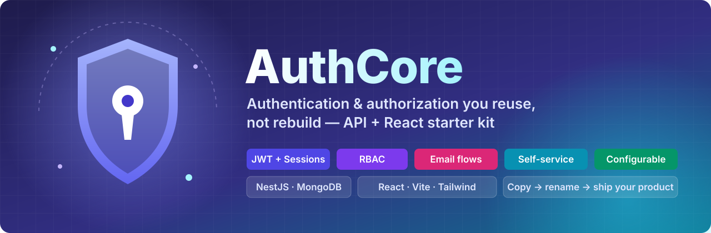
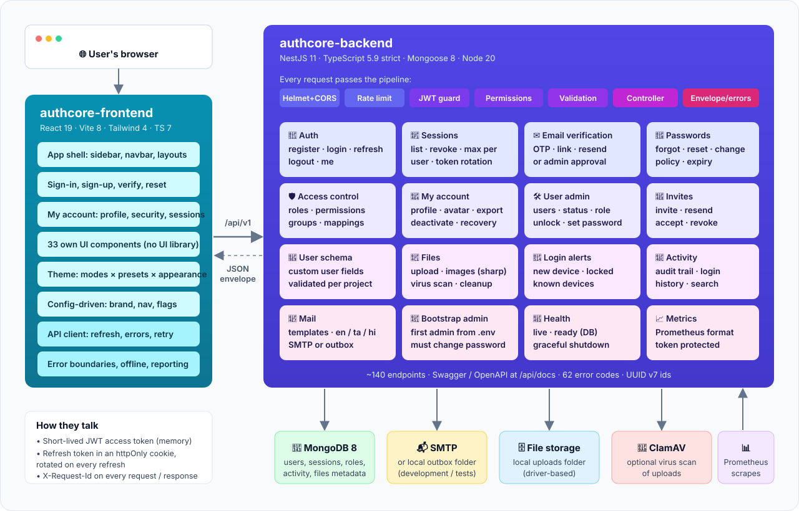
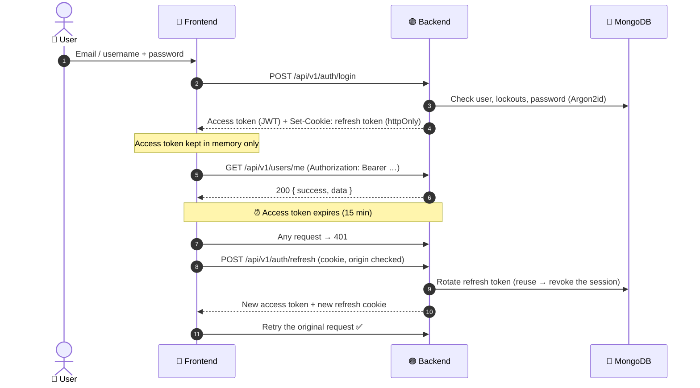
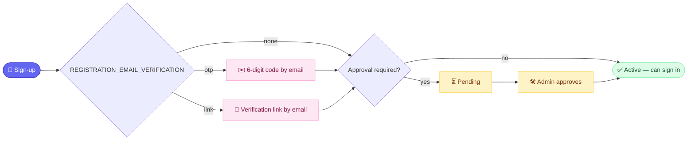
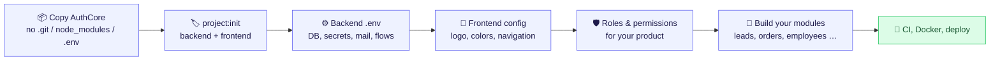

<div align="center">



<br />

**A production-grade authentication & authorization backend + a React starter kit.**<br />
Start every new product (CRM, e-commerce, HRMS, ERP, SaaS, admin panel …) with sign-in, sessions, roles, permissions and account screens **already done**.

<br />


[✨ Features](#-features) •
[🏗️ Architecture](#%EF%B8%8F-architecture) •
[🚀 Quick start](#-quick-start) •
[🆕 New project](#-start-a-new-product-from-authcore) •
[🔌 API](#-api-at-a-glance) •
[📊 Status](#-project-status--roadmap) •
[📚 Docs](#-documentation)

</div>

---

## 💡 What is AuthCore?

Every product needs the same 40 % of plumbing before the first business screen: sign-up, email verification, sign-in, sessions, password resets, roles, permissions, user admin, profile pages, audit logs, security emails. **AuthCore is that 40 %, built once, properly, and reused.**

<table>
<tr>
<td width="50%" valign="top">

### 🟣 `authcore-backend`

The **service**: a NestJS + MongoDB API with every identity and access feature, secure by default, configured entirely through `.env`.

- 🔑 Registration, login, JWT + rotating refresh tokens
- 🛡️ Roles, permissions, groups, access mappings (RBAC)
- 👤 Account self-service and 🛠️ user administration
- ✉️ Localized emails, 📁 file uploads, 📈 metrics
- 🧪 16 end-to-end test suites + CI

</td>
<td width="50%" valign="top">

### 🔵 `authcore-frontend`

The **starter kit**: a React app shell and design system that talks to the backend, configured entirely through `src/config/`.

- 🧭 Config-driven sidebar, navbar, routing, layouts
- 🎨 Theme system: modes × color presets × appearance
- 🧱 33 hand-built, accessible UI components (no UI library)
- 🔐 Auth and account screens wired to the API
- 🧯 Robust API client and error handling

</td>
</tr>
</table>

> [!TIP]
> **The idea:** copy AuthCore → run `project:init` with your product name → choose your auth flows in `.env` / config → build only your business modules. Step-by-step: [docs/new-project-guide.md](docs/new-project-guide.md).

---

## ✨ Features

### 🔐 Identity & authentication

| | Feature | Details |
| :---: | --- | --- |
| 📝 | **Registration — 4 flows** | Direct, email **OTP**, email **link**, or **admin approval**; switch with `REGISTRATION_EMAIL_VERIFICATION` / `REGISTRATION_REQUIRE_APPROVAL` |
| 🔑 | **Login** | Email and / or username (`LOGIN_IDENTIFIERS`), "remember me", Argon2id password hashing |
| 🎟️ | **Tokens** | Short-lived JWT access token (15 min default) + refresh token in an **httpOnly cookie**, **rotated** on every use with **reuse detection** and a CSRF **origin check**; JWT secret rotation without signing users out |
| 📱 | **Sessions & devices** | List and revoke sessions, log out everywhere, max sessions per user, known devices, **new-device sign-in alerts** |
| 🔁 | **Passwords** | Forgot / reset (OTP or link), change password, **password policy** (rules, history, expiry, reminders), admin set / force reset, password generator |
| 🚫 | **Brute-force protection** | Lockouts per account **and** per IP, account-locked email, global rate limiting |

### 🛡️ Authorization & administration

| | Feature | Details |
| :---: | --- | --- |
| 🧑‍🤝‍🧑 | **RBAC** | Roles, permissions, **groups** (with optional parent inheritance), access mappings, "my effective access" endpoint, access audit log, protected system roles |
| 🛠️ | **User administration** | Search, create, edit, status (approve / suspend), role, unlock, revoke sessions, set password, soft delete, restore, permanent delete |
| 📨 | **Invitations** | Single and bulk invites, resend, revoke, accept page, invite language |
| 🧩 | **User schema** | Per-project **custom user fields** (validated), shown in profile and admin |
| 👑 | **Bootstrap admin** | First administrator created from `.env`, forced to change the password |
| 📜 | **Audit & activity** | Activity log per user, admin activity search, login history, retention settings |

### 👤 Account self-service

Profile and personal details · avatar upload (resized with sharp) · preferences (language, time zone) · **email change** with confirmation · **data export** (download) · deactivate · delete with grace period · **self account recovery**.

### ⚙️ Platform & operations

| | Feature | Details |
| :---: | --- | --- |
| ✉️ | **Mail** | Templates in **English, Tamil, Hindi**; SMTP in production, a local **outbox folder** in development and tests |
| 📁 | **Files** | Uploads with size / type limits, image re-encoding, **ClamAV virus scanning** (optional), orphan cleanup, public / private files |
| 💓 | **Health** | `/health`, `/health/live`, `/health/ready` (MongoDB), graceful shutdown |
| 📈 | **Metrics** | Prometheus endpoint, token protected |
| 🧱 | **Standards** | One response envelope, **62 typed error codes**, `X-Request-Id` on every call, UUID v7 ids, Swagger / OpenAPI |
| 🏷️ | **Rebranding** | `project.config.json` + `npm run project:init` (backend) and `app.config.ts` + `npm run project:init` (frontend) |

### 🎨 Frontend starter kit

| | Feature | Details |
| :---: | --- | --- |
| 🧭 | **App shell** | Sidebar (groups, submenus, badges, collapse, mobile drawer), navbar (search, command menu `Ctrl+K`, notifications, theme, user menu), breadcrumbs |
| 🗺️ | **Config-driven** | Branding, navigation, feature flags, layout and theme from `src/config/` — no component edits; planned modules get a "not built yet" page |
| 🎨 | **Theme system** | Light / dark / system × 7 color presets (incl. your brand color) × appearance (radius, density, sidebar, cards …); **no flash** on load; contrast checked in CI |
| 🧱 | **Design system** | 33 hand-built components — dialog, sheet, dropdown, select, combobox, command palette, table, tabs, toasts … — keyboard + screen-reader ready |
| 🔌 | **API client** | Envelope unwrapping, one shared token refresh, timeouts, cancellation, request ids, uploads with progress, downloads |
| 🧯 | **Error handling** | Field errors on forms, toasts for actions, 403 / 404 / offline / 5xx states, error boundaries, auto-reload after deploys, error-report hook |
| ♿ | **Responsive & a11y** | 375 → 1920 px, skip link, focus management, reduced motion, WCAG contrast |
| ✅ | **Guard rails** | `npm run verify`: format, lint, types, **architecture rules**, contrast, error-code sync with the backend, build |

---

## 🏗️ Architecture

<div align="center">

</div>

### 🔄 How sign-in and token refresh work



### 📝 Registration flows (pick one per project)



---

## 📁 Repository structure

```text
AuthCore/
├── 🟣 authcore-backend/            NestJS API — the service
│   ├── src/
│   │   ├── main.ts                 Bootstrap: security, logging, Swagger, graceful shutdown
│   │   ├── app.module.ts           Global guards (JWT, permissions, throttling), pipes, interceptors, filters
│   │   ├── config/                 Typed configuration + Joi validation of every env variable
│   │   ├── database/               MongoDB connection, base schema (UUID v7), plugins, index scripts
│   │   ├── common/                 Filters, interceptors, guards, decorators, DTOs, error codes, logger
│   │   └── modules/                auth · sessions · email-verification · password-reset · password-policy ·
│   │                               access-control · account · user-admin · user-invites · user-schema ·
│   │                               users · files · mail · login-alerts · user-activity · bootstrap ·
│   │                               health · metrics
│   ├── test/e2e/                   16 black-box end-to-end suites (own port + database)
│   ├── project.config.json         Product name, slug, branding (npm run project:init)
│   ├── Dockerfile                  Multi-stage, non-root, healthcheck
│   └── .env.example                Every variable, documented, with defaults
│
├── 🔵 authcore-frontend/           React starter kit
│   ├── src/
│   │   ├── app/                    App, providers, router, routes/, layouts/ (sidebar, navbar, guards), theme/
│   │   ├── components/             ui/ (design system), common/, page/, feedback/
│   │   ├── features/               auth/, account/, dashboard/, settings/ — one folder per business area
│   │   ├── config/                 app, features, navigation, layout, theme, paths, icons, env
│   │   ├── hooks/                  Generic React hooks
│   │   ├── lib/                    api/ (client), errors/, format/, utils/, constants/, storage
│   │   ├── pages/                  404, 403, route error, planned pages, dev/ (kitchen sink)
│   │   └── styles/                 Design tokens, theme presets, appearance
│   ├── scripts/                    project-init, architecture / contrast / error-code checks
│   └── CHANGELOG.md                Breaking changes for earlier copies
│
├── 📘 docs/                        Planning, guides and checklists (backend/ and frontend/)
│   ├── new-project-guide.md        Start a new product from AuthCore
│   └── assets/                     Images used in the READMEs
│
└── ⚙️ .github/workflows/           backend-ci.yml · frontend-ci.yml
```

---

## 🧰 Tech stack

<table>
<tr>
<th>🟣 Backend</th>
<th>🔵 Frontend</th>
</tr>
<tr>
<td valign="top">

| Area | Technology |
| --- | --- |
| Runtime | Node.js 20.19 |
| Framework | NestJS 11, TypeScript 5.9 strict |
| Database | MongoDB 8 + Mongoose 8 |
| Auth | `@nestjs/jwt`, Argon2id (`@node-rs/argon2`) |
| Validation | class-validator, Joi (env) |
| Security | helmet, throttler, CORS allowlist |
| Mail | nodemailer (SMTP / outbox) |
| Files | multer, sharp, ClamAV |
| Observability | Winston, Terminus, prom-client |
| API docs | Swagger / OpenAPI |
| Quality | ESLint, Prettier, madge, e2e suites |

</td>
<td valign="top">

| Area | Technology |
| --- | --- |
| UI runtime | React 19 |
| Build | Vite 8, TypeScript 7 |
| Styling | Tailwind CSS 4 + design tokens |
| Routing | React Router 7 (data router) |
| Icons | lucide-react |
| Class helpers | clsx, tailwind-merge |
| Components | **Our own** (no Radix / MUI / shadcn) |
| Lint | oxlint (incl. React-compiler rules) |
| Format | Prettier (+ import / class sorting) |
| Checks | architecture, contrast, error codes |
| Testing | Manual checklists + `/dev/ui` |

</td>
</tr>
</table>

Every dependency and why it's there: [backend techstack](docs/backend/techstack.md) · [frontend techstack](docs/frontend/techstack.md).

---

## 🚀 Quick start

### 📋 Prerequisites

- 🟢 **Node.js 20.19** (`.nvmrc` in each app) and npm 10
- 🍃 **MongoDB 8** on `mongodb://localhost:27017` (or any reachable instance)
- 🐳 Docker — optional

### 1️⃣ Backend

```bash
cd authcore-backend
npm ci
cp .env.example .env        # set MONGODB_URI, CORS_ORIGIN, JWT_ACCESS_SECRET, VERIFICATION_TOKEN_SECRET
npm run start:dev           # http://localhost:3000
```

> [!TIP]
> Keep `MAIL_TRANSPORT=outbox` while developing: emails (OTP codes, links) are written to `authcore-backend/mail-outbox/` instead of being sent. Set `BOOTSTRAP_ADMIN_*` to get a first administrator.

### 2️⃣ Frontend

```bash
cd authcore-frontend
npm ci
cp .env.example .env        # defaults work: /api is proxied to localhost:3000
npm run dev                 # http://localhost:5173
```

### 3️⃣ Open it

| | URL | What |
| :---: | --- | --- |
| 🖥️ | http://localhost:5173 | The app — sign up or sign in with the bootstrap admin |
| 🧱 | http://localhost:5173/dev/ui | UI kit: every component, theme customizer, usage notes *(dev only)* |
| 🧪 | http://localhost:5173/dev/api | API playground *(dev only)* |
| 📖 | http://localhost:3000/api/docs | Swagger UI *(development / staging)* |
| 📄 | http://localhost:3000/api/docs/openapi.json | OpenAPI JSON (import into Postman) |
| 💚 | http://localhost:3000/api/v1/health/ready | Readiness (includes MongoDB) |

> [!NOTE]
> The backend **refuses to start** when an environment variable is missing or invalid and names the exact variable. The frontend shows a **Configuration problems** page in development for invalid config.

---

## 🆕 Start a new product from AuthCore



```bash
# Same name and slug in both apps
cd authcore-backend  && npm run project:init -- --name "Nexa CRM" --slug nexa-crm
cd ../authcore-frontend && npm run project:init -- --name "Nexa CRM" --slug nexa-crm --color "#0f766e"
```

| Product type | Sign-up | Verification | Approval |
| --- | --- | --- | --- |
| 🏢 Internal tool / ERP / HRMS | Off (invites only) | — | — |
| 🤝 B2B CRM | Off or invites | link | optional |
| 🛒 E-commerce (customers) | On | otp or link | off |
| ☁️ SaaS self-service | On | link | off |

📘 Full walkthrough (12 steps, with a final checklist): **[docs/new-project-guide.md](docs/new-project-guide.md)** · frontend in 10 minutes: **[authcore-frontend/README.md](authcore-frontend/README.md#start-a-new-project-in-10-minutes)**

---

## 🔌 API at a glance

All routes are under **`/api/v1`**. Secure by default: every route needs a valid token unless marked public, and admin routes check permissions.

| Area | Base path | Endpoints | Highlights |
| --- | --- | :---: | --- |
| 🔑 Auth | `/auth` | 13 | register, login, refresh, verify email (OTP / link / resend), logout, logout-all, me, forgot / reset / change password |
| 📱 Sessions | `/auth/sessions` | 3 | list, revoke one, revoke others |
| 👤 My account | `/users/me` · `/users/me/devices` · `/account/recovery` | 17 | profile, attributes, avatar, preferences, email change, export, deactivate, delete, devices, recovery |
| 🛠️ User admin | `/admin/users` | 21 | list, create, edit, status, role, unlock, sessions, set / force password, delete, restore, purge |
| 📜 Activity | `/admin/activity` | 3 | activity search, login history, event types |
| 📨 Invites | `/user-invites` | 9 | invite, bulk, resend, revoke, public info, accept |
| 🛡️ Access control | `/roles` · `/permissions` · `/groups` · `/access-mappings` · `/access-control` | 45 | CRUD, assignments, effective access |
| 📏 Password policy | `/password-policies` | 9 | rules, requirements (public), expiry, reminders |
| 🧩 User schema | `/user-schema` | 7 | custom user fields |
| 📁 Files | `/files` | 7 | upload, list, content, public files, delete, orphan cleanup |
| 💓 Health / 📈 Metrics | `/health` · `/metrics` | 4 | live, ready, overall, Prometheus |

**Response envelope** — the same shape everywhere:

```jsonc
// ✅ success
{ "success": true, "message": "Login successful", "data": { … }, "meta": { "page": 1, "limit": 20, "totalItems": 57, "totalPages": 3, "hasNextPage": true, "hasPreviousPage": false }, "timestamp": "…", "path": "/api/v1/…" }

// ❌ error
{ "success": false, "message": "Validation failed", "code": "VALIDATION_ERROR", "errors": [{ "field": "email", "message": "email must be an email" }], "statusCode": 400, "timestamp": "…", "path": "/api/v1/…" }
```

- 🏷️ `X-Request-Id` on every response (send your own to trace a request end to end) · ⏳ `Retry-After` on 429
- 🔢 62 stable error `code`s — mirrored in the frontend and checked by `npm run check:error-codes`
- 🕒 Dates in ISO 8601 UTC · 🆔 UUID v7 ids · 📄 pagination via `page` / `limit`

Full endpoint reference: [authcore-backend/README.md → Implemented endpoints](authcore-backend/README.md#implemented-endpoints) · live docs at `/api/docs`.

---

## 🛡️ Security highlights

| | |
| --- | --- |
| 🔒 **Argon2id** password hashing | 🍪 Refresh token in **httpOnly, SameSite** cookie, **rotated** with **reuse detection** |
| 🌍 **Origin check** on refresh (CSRF) + CORS allowlist (`*` rejected) | 🚦 **Rate limiting** + lockouts per account **and** per IP |
| 🔐 **Secure by default** — routes need auth unless marked public | 🗝️ **JWT secret rotation** (`JWT_ACCESS_PREVIOUS_SECRETS`) without logging users out |
| 🪖 **helmet** headers, body-size limit, request timeouts | 🦠 Upload **virus scanning** (ClamAV) and image re-encoding |
| 📏 Password **policy, history and expiry** | 🔔 **New-device** and **account-locked** emails |
| 🧾 Audit trail + login history | 🙈 Access token only in memory on the frontend; token sent only to API URLs |

> [!CAUTION]
> Never commit `.env` files. Production needs fresh `JWT_ACCESS_SECRET` / `VERIFICATION_TOKEN_SECRET`, `REFRESH_COOKIE_SECURE=true`, `SWAGGER_ENABLED=false`, `MAIL_TRANSPORT=smtp` and a `METRICS_TOKEN`.

---

## ⚙️ Configuration

<table>
<tr>
<th>🟣 Backend — <code>.env</code> (~108 variables, all validated)</th>
<th>🔵 Frontend — <code>src/config/</code> + <code>.env</code></th>
</tr>
<tr>
<td valign="top">

| Group | Examples |
| --- | --- |
| Required | `MONGODB_URI`, `CORS_ORIGIN`, secrets |
| Registration | `REGISTRATION_EMAIL_VERIFICATION`, `REGISTRATION_REQUIRE_APPROVAL` |
| Login & tokens | `LOGIN_IDENTIFIERS`, `JWT_ACCESS_TTL_SECONDS`, `REFRESH_TOKEN_*` |
| Lockouts | `LOGIN_MAX_FAILED_ATTEMPTS*`, `LOGIN_LOCKOUT_MINUTES` |
| Passwords | `PASSWORD_RESET_METHOD`, `PASSWORD_RESET_*` |
| Account | `ACCOUNT_DELETION_GRACE_DAYS`, retention days |
| Mail | `MAIL_TRANSPORT`, `MAIL_FROM`, `MAIL_DEFAULT_LANGUAGE` |
| Files | `STORAGE_*`, `UPLOAD_*`, `IMAGE_*`, `VIRUS_SCAN_*` |
| Admin | `BOOTSTRAP_ADMIN_*`, `INVITE_*` |
| Ops | `METRICS_*`, `LOG_*`, `THROTTLE_*`, `SHUTDOWN_TIMEOUT_MS` |

[`.env.example`](authcore-backend/.env.example) · [full reference](authcore-backend/README.md#3-environment-variables)

</td>
<td valign="top">

| File | What you set |
| --- | --- |
| `app.config.ts` | Name, logos, favicon, brand color, locale, legal |
| `features.config.ts` | Auth flows, account pages, admin, UI toggles |
| `navigation.config.ts` | Sidebar groups / items / permissions |
| `layout.config.ts` | Sidebar, navbar actions, content width |
| `theme.config.ts` | Default mode, preset, appearance |
| `paths.ts` | Every URL |
| `.env` | `VITE_API_BASE_URL`, `VITE_API_TIMEOUT_MS` |

[Configuration guide](authcore-frontend/README.md#configuration-guide) · [theme system](docs/frontend/theme-system.md)

</td>
</tr>
</table>

> [!IMPORTANT]
> **Auth flows must match** between backend `.env` and frontend `features.config.ts → auth` (registration flow, login identifiers, remember me). See [new-project guide, step 7](docs/new-project-guide.md#step-7--choose-the-auth-flows-).

---

## 🛠️ Scripts

<table>
<tr>
<th>🟣 Backend (<code>authcore-backend/</code>)</th>
<th>🔵 Frontend (<code>authcore-frontend/</code>)</th>
</tr>
<tr>
<td valign="top">

| Script | Purpose |
| --- | --- |
| `start:dev` | Watch mode on :3000 |
| `build` / `start:prod` | Compile / run `dist/` |
| ✅ `verify` | Lint, format, types, circular imports, build |
| 🧪 `test:e2e` | All end-to-end suites (needs MongoDB) |
| `openapi:export` | Write the OpenAPI spec |
| `db:indexes[:apply]` | Report / create indexes |
| `users:pending` / `approve` / `reject` / `role` | User admin from the CLI |
| `project:init` | Rename for a new product |
| `audit:prod` | Dependency vulnerability scan |

</td>
<td valign="top">

| Script | Purpose |
| --- | --- |
| `dev` | Dev server on :5173 (proxy to :3000) |
| `build` / `preview` | Production build / serve it |
| ✅ `verify` | Format, lint, types, architecture, contrast, error codes, build |
| `check:architecture` | Project rules (no hard-coded colors, no `fetch` in UI, no `<select>` …) |
| `check:contrast` | WCAG contrast of every preset × mode |
| `check:error-codes` | Error codes match the backend |
| `project:init` | Rename / rebrand for a new product |

</td>
</tr>
</table>

> [!IMPORTANT]
> Run `npm run verify` in the app you changed **before every commit** — CI runs the same checks.

---

## 🧪 Quality & testing

| | Backend | Frontend |
| --- | --- | --- |
| 🧹 Static checks | ESLint (strict, type-checked), Prettier, `tsc`, madge (no circular imports) | oxlint (+ React-compiler rules), Prettier, `tsc`, architecture / contrast / error-code checks |
| 🧪 Tests | **16 black-box e2e suites** — start the built app on port 3999 with its own `*_e2e` database and an outbox (no real email) | **Manual** checklists + `/dev/ui` kitchen sink (no automated test framework, by decision) |
| ⚙️ CI | `backend-ci.yml`: verify → audit → e2e (MongoDB service) | `frontend-ci.yml`: verify → audit |

---

## 🐳 Docker & deployment

```bash
# Backend image (from authcore-backend/)
docker build -t authcore-backend .
docker run --rm -p 3000:3000 \
  -e MONGODB_URI="mongodb://host.docker.internal:27017/authcore" \
  -e CORS_ORIGIN="http://localhost:5173" \
  -e JWT_ACCESS_SECRET="…" -e VERIFICATION_TOKEN_SECRET="…" \
  -v authcore-uploads:/app/uploads \
  authcore-backend
```

- 👤 Runs as non-root with `tini`; `HEALTHCHECK` on `/api/v1/health/live`; use `/health/ready` for the load balancer.
- 🏭 `NODE_ENV=production`: JSON logs, Swagger off, auto-indexing off (run `npm run db:indexes:apply`).
- 🌐 **Frontend:** `npm run build` → static `dist/` behind nginx (or any static host) with SPA fallback and `/api` proxied to the backend — same origin keeps the refresh cookie simple. Example config: [frontend README → Deployment](authcore-frontend/README.md#deployment).
- 🔒 HTTPS in production, `TRUST_PROXY_HOPS` set to your proxy count.

---

## 📊 Project status & roadmap

| Track | Level 1 — foundation | Level 2 | Level 3 |
| --- | --- | --- | --- |
| 🟣 **Backend** | ✅ Core identity & access working (modules 1–12 largely complete, 18 in part — see the checklist) · ⏳ MFA, OAuth, passwordless, multi-tenancy, API keys (13–17), testing & DevOps extras (19–20) | Advanced tokens / JWKS, recovery, risk-based auth, SSO (21–24) | Support tools, compliance, SCIM provisioning, security testing (25–28) |
| 🔵 **Frontend** | ✅ Starter kit done (modules 1–14, 16) · ⏳ manual verification pass (15) | Every backend feature in the UI: admin users, access control, policies, files … (17–26) | i18n, monitoring, performance, PWA, deployment, MFA UI (27–34) |

<details>
<summary><b>🟣 Backend — what's done</b> (click to expand)</summary>

| Area | Status |
| --- | :---: |
| 🧱 Foundation: config validation, database, architecture, API standards, Swagger, code quality | ✅ |
| 🛡️ Security, errors, responses, logging, health, graceful shutdown, performance | ✅ |
| 📝 Registration: direct / email OTP / email link / admin approval | ✅ |
| 🔑 Login (email / username), JWT, sessions, lockouts (account + IP) | ✅ |
| 🔄 Refresh token rotation, reuse detection, CSRF origin check | ✅ |
| 🚪 Logout, logout everywhere, session and device management | ✅ |
| 🔐 Forgot / reset / change password, password policy, expiry reminders | ✅ |
| 🧑‍🤝‍🧑 RBAC: roles, permissions, groups, access mappings | ✅ |
| 👤 My account: profile, preferences, email change, export, deactivate / delete, recovery | ✅ |
| 🛠️ User administration, invites (single + bulk), admin set password | ✅ |
| 📁 File uploads, avatars, virus scanning, orphan cleanup | ✅ |
| 👑 Bootstrap admin, 🧩 user schema (custom fields), 📜 activity & login history | ✅ |
| 🔔 New-device alerts, account-locked email, default groups | ✅ |
| 📈 Metrics, JWT key rotation, localized emails (en / ta / hi) | ✅ |
| 🧪 16 e2e suites + GitHub Actions CI · 🐳 Dockerfile | ✅ |
| 🏷️ `project.config.json` + `project:init` | ✅ |
| 🔐 MFA, OAuth / social login, passwordless, multi-tenancy, API keys | ⏳ Planned |
| 🐳 Docker Compose, deployment docs | ⏳ Planned |

</details>

<details>
<summary><b>🔵 Frontend — what's done</b> (click to expand)</summary>

| Module | Status |
| --- | :---: |
| 1. Project setup & code quality (`verify`, CI) | ✅ |
| 2. Configuration system + `project:init` | ✅ |
| 3. Theme & design tokens (rounded-md, no shadows by default) | ✅ |
| 4. UI component library — 33 hand-built components | ✅ |
| 5. Routing (React Router data router, lazy pages) | ✅ |
| 6–8. Layouts, sidebar, navbar, command menu | ✅ |
| 9. Responsive & accessibility | ✅ |
| 10. Page & feedback components | ✅ |
| 11–12. Hooks & utilities | ✅ |
| 13. API layer | ✅ |
| 14. Error handling | ✅ |
| 15. Manual verification pass | ⏳ |
| 16. Documentation (README, guide, usage notes, changelog) | ✅ |
| Auth & account screens (sign-in, sign-up, verify, reset, recovery, profile, security, sessions, activity) | ✅ working, polished in Level 2 |

</details>

---

## 📚 Documentation

| | Document | What's inside |
| :---: | --- | --- |
| 🆕 | [docs/new-project-guide.md](docs/new-project-guide.md) | **Start a new product from AuthCore** — 12 steps + final checklist |
| 🗂️ | [docs/README.md](docs/README.md) | Index of all planning documents |
| 👩‍💻 | [authcore-backend/README.md](authcore-backend/README.md) | Backend developer guide: env reference, architecture, database, endpoints |
| 👩‍💻 | [authcore-frontend/README.md](authcore-frontend/README.md) | Frontend developer guide: config, theme, recipes, deployment, troubleshooting |
| 📝 | [authcore-frontend/CHANGELOG.md](authcore-frontend/CHANGELOG.md) | Breaking starter-kit changes for earlier copies |
| 🧪 | [authcore-backend/test/e2e/README.md](authcore-backend/test/e2e/README.md) | End-to-end suites and how they're isolated |

<details>
<summary><b>🟣 Backend planning docs</b></summary>

| | Document | Contents |
| :---: | --- | --- |
| 🧭 | [overview.md](docs/backend/overview.md) | Goals, scope (28 modules), build levels |
| 🟩 | [level-1-modules.md](docs/backend/level-1-modules.md) | Modules 1–20 (foundation) with the sprint plan |
| 🟨 | [level-2-modules.md](docs/backend/level-2-modules.md) | Modules 21–24: advanced security and identity |
| 🟥 | [level-3-modules.md](docs/backend/level-3-modules.md) | Modules 25–28: enterprise IAM and compliance |
| ✅ | [project-setup-checklist.md](docs/backend/project-setup-checklist.md) | Every setup decision, convention and verification |
| 🛡️ | [access-control-checklist.md](docs/backend/access-control-checklist.md) | Roles, permissions, groups, access mapping |
| 🧰 | [techstack.md](docs/backend/techstack.md) | Technology stack and versions |

</details>

<details>
<summary><b>🔵 Frontend planning docs</b></summary>

| | Document | Contents |
| :---: | --- | --- |
| 🧭 | [overview.md](docs/frontend/overview.md) | Starter kit + AuthCore client, principles |
| ✅ | [project-setup-checklist.md](docs/frontend/project-setup-checklist.md) | Tooling and foundation checklist |
| 🗂️ | [folder-structure.md](docs/frontend/folder-structure.md) | Every folder and file, import rules, naming |
| 🎨 | [theme-system.md](docs/frontend/theme-system.md) | Modes, presets, appearance, design tokens |
| 🟩 | [level-1-modules.md](docs/frontend/level-1-modules.md) | Modules 1–16: the starter kit, acceptance checklist |
| 🟨 | [level-2-modules.md](docs/frontend/level-2-modules.md) | Modules 17–26: every backend feature in the UI |
| 🟥 | [level-3-modules.md](docs/frontend/level-3-modules.md) | Modules 27–34: production and enterprise |
| 🧰 | [techstack.md](docs/frontend/techstack.md) | Packages, versions, decisions |

</details>

---

## 🤝 Working on AuthCore

- 🧭 **Follow the structure and rules** in each app's README — they keep every product built from AuthCore on the same shape, so improvements can move between them.
- ✅ **`npm run verify` must pass** before every commit; add backend e2e coverage when you change an API.
- 🔁 **Keep both sides in sync:** a new backend error code goes into the frontend mirror; a changed API shape gets an entry in the frontend CHANGELOG if copies need to follow.
- 🔙 **Port generic fixes back:** a bug fixed or a feature added in a product that every product needs belongs in AuthCore.
- 🚫 Never commit `.env`, secrets, `uploads/` or `mail-outbox/`.

---

<div align="center">


**🔐 AuthCore** — build the product, not the login page.

</div>
